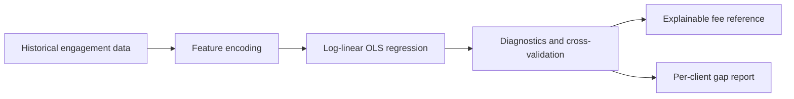

# CPA Pricing Analytics

An explainable, browser-based pricing analytics prototype designed around the real workflow of a Taiwan CPA firm.

**[Open the live demo](https://christineliu0221-tech.github.io/cpa-pricing-analytics/)**

> **Privacy notice:** Every company name and financial figure in this public repository is synthetic. No client data, engagement records, or confidential firm information is included.

## Why I built it

Professional-service pricing often depends on fragmented historical records and experience-based judgment. This project explores a more consistent workflow: structure past engagements, model the factors that drive effort, and turn the result into an explainable pricing reference.

The project combines my accounting-domain experience with AI-assisted product development: I framed the pricing problem and the engagement factors from CPA practice, and built the tool with AI coding assistants.

## What it does

- Manages historical bookkeeping and annual tax-attestation engagements.
- Imports and exports CSV data and supports published Google Sheets CSV links.
- Fits a log-linear OLS regression in the browser: `ln(fee)` on log-scaled size drivers (vouchers, headcount, assets, revenue) plus engagement flags, so each factor reads as a percentage effect.
- Automatically leaves out factors with too little variation in the data (fewer than 5 records differ) and says which ones.
- Reports R², adjusted R², RMSE, leave-one-out cross-validation error (median % error and share within ±25%), coefficients, and per-factor contribution.
- Produces an indicative fee and a proportional range (`prediction × e^(±1.5σ)` on the log scale), and warns when an engagement is larger or smaller than almost everything in the history.
- Exports a per-client gap report (actual fee vs. model estimate, range, and below / within / above-range flag) to CSV.
- Asks whether to replace or append when importing into a non-empty dataset, and can clear a service's data in one click.
- Stores user-entered data locally in the browser; the demo has no application backend.

## Product workflow



## Technical highlights

- **Frontend:** semantic HTML, responsive CSS, vanilla JavaScript
- **Data handling:** Papa Parse for CSV workflows
- **Visualization:** Chart.js
- **Modeling:** log-linear OLS solved with Gaussian elimination and leave-one-out cross-validation, implemented in JavaScript
- **Persistence:** browser `localStorage`
- **Architecture:** static, dependency-light, and deployable on GitHub Pages

The model uses domain-informed feature encoding for engagement complexity, including service volume, revenue band, staffing, industry, add-on services, accounting readiness, audit scope, and risk.

## Run locally

No build step is required. Clone the repository and open `index.html` in a modern browser.

```bash
git clone https://github.com/christineliu0221-tech/cpa-pricing-analytics.git
cd cpa-pricing-analytics
```

Then open `index.html`, or serve the directory with any static web server.

## Using the demo

The synthetic dataset loads automatically on your first visit.

1. **歷史數據** (Historical data) shows the synthetic engagement records.
2. Open **回歸分析** (Regression analysis) to inspect model diagnostics and coefficients.
3. Open **報價計算機** (Fee calculator) to enter a hypothetical engagement and view the estimate.

The product interface is intentionally in Traditional Chinese because it was designed for Taiwan CPA workflows. The repository documentation is in English for an international portfolio audience.

## Why a log model

Fees scale proportionally with engagement size: doubling a client's vouchers or assets raises effort by a similar percentage, not by a fixed amount. A linear model lets one very large client dominate the fit and can even flip the sign of a size factor. Taking logs keeps large clients from swamping the rest, makes the residuals more even across fee levels, and gives coefficients that are easy to explain ("+15% per doubling of monthly vouchers").

In-sample R² flatters small datasets, so the analysis page also shows leave-one-out cross-validation error: each client is predicted by a model fitted without it.

## Responsible-use notes

This is a portfolio prototype, not production pricing, accounting, tax, or audit advice. Regression estimates can be unstable with small or highly correlated datasets, and the cross-validation error is the better guide to how far a quote may be off. A production system should add stronger validation, access controls, encrypted storage, model monitoring, and professional review.

## Author

Built by [Christine Liu](https://github.com/christineliu0221-tech) with AI coding assistants, combining CPA-domain knowledge with data-driven product thinking.
